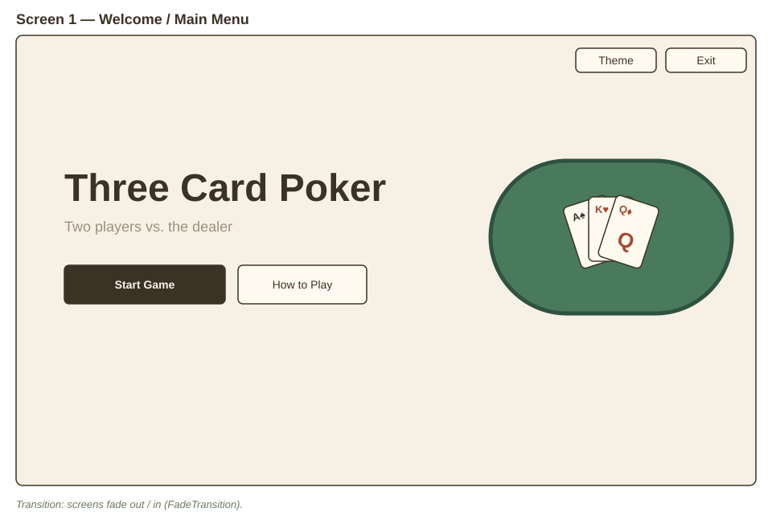
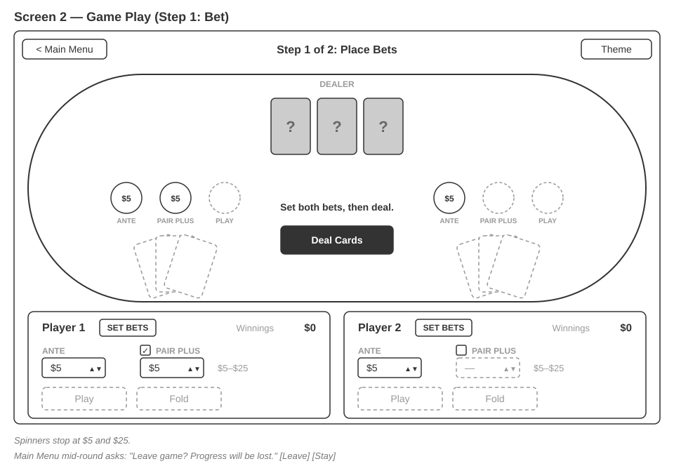
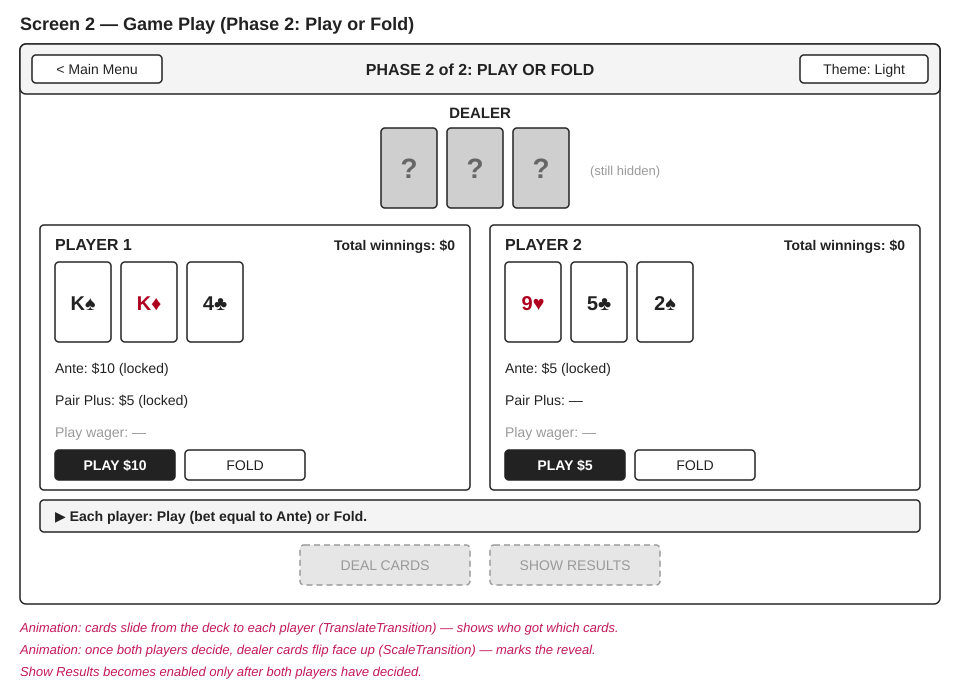
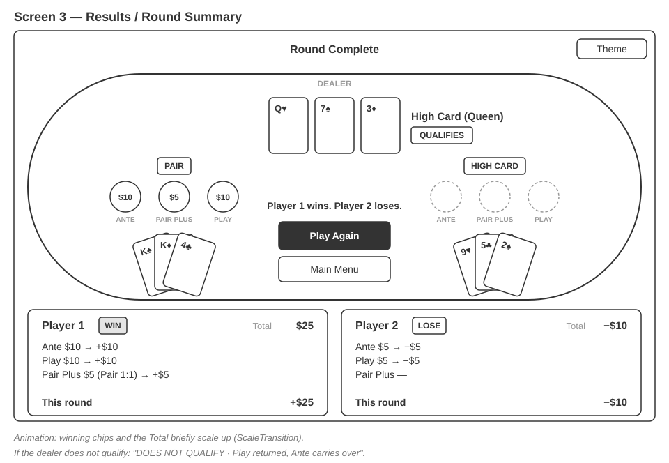
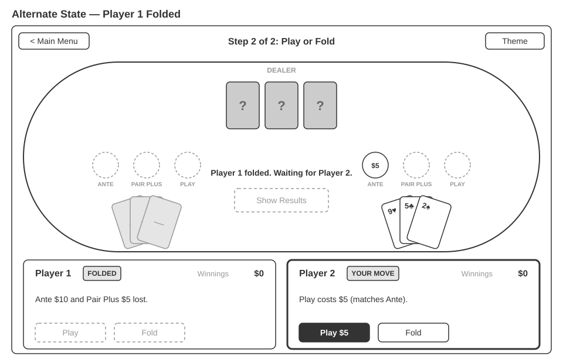
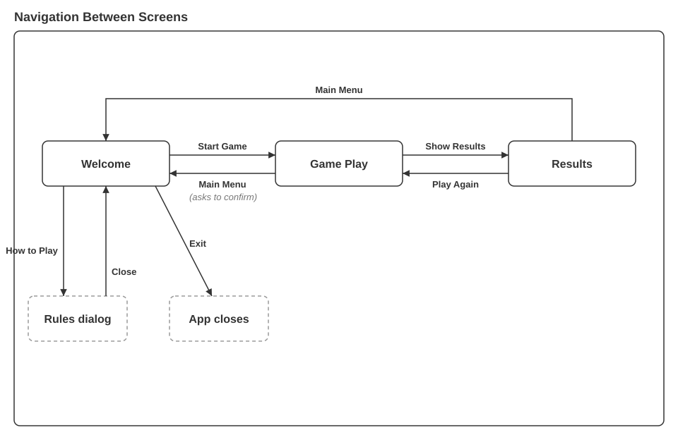

# 1. Wireframes

# 2. Alternate State

# 3. Navigation

# 4. Software Architecture

- **Model:** `Card` (suit, value 2–14), `Deck` (52 cards; initialize, shuffle, reset), `Dealer` (owns the deck, deals 3-card hands), `Player` (hand, ante, pair plus, play wager, winnings).
- **Game logic and payouts:** `ThreeCardLogic`, with static `evalHand`, `evalPPWinnings` and `compareHands`.
- **Game service:** `GameService` holds the dealer, both players and the current phase. It takes bets, deals, records Play/Fold, resolves the round, updates winnings and starts the next round.
- **FXML controllers:** `WelcomeController`, `GameController`, `ResultsController`, one per screen. They handle events, call `GameService` and update the UI. They contain no rules or payout math.
- **Screen navigation:** `App` owns the `Stage`. `show(fxml)` swaps scenes and applies the current theme stylesheet.

Game rules stay independent of the UI because the model, logic and service classes do not use JavaFX. Controllers only call `GameService`, so the logic can be unit-tested without launching the UI.

# 5. Usability Testing

**Tasks:** (1) Start a new game. (2) Place Ante and Pair Plus bets. (3) Play or fold. (4) Find the round results. (5) Start another round, then return to the main menu.

> **TODO:** fill in from sessions with two students who are not on your team.

**Participant 1:**

| Task | Completed? | Hesitation / confusion | Questions asked |
|---|---|---|---|
| 1 | | | |
| 2 | | | |
| 3 | | | |
| 4 | | | |
| 5 | | | |

Suggestions:

**Participant 2:**

| Task | Completed? | Hesitation / confusion | Questions asked |
|---|---|---|---|
| 1 | | | |
| 2 | | | |
| 3 | | | |
| 4 | | | |
| 5 | | | |

Suggestions:

# 6. Usability Findings

1.
2.
3.

# 7. Wireframe Revisions

**Revision 1:** Before / After / Why:

**Revision 2:** Before / After / Why:

# 8. UI/UX Principles

- **Feedback:** the progress bar, the message on the felt and the player status labels always show the phase and the next action.
- **Error prevention:** bets are limited to $5–$25, invalid actions are disabled, and leaving mid-round asks for confirmation.
- **Consistency:** both seats share one layout, and the main action is always in the center of the table.
- **Visual hierarchy:** each screen has one filled primary button, and results lead with the outcome.
- **Accessibility:** controls are keyboard-accessible, and WIN/LOSE/FOLDED are written in text, not shown by color alone.
